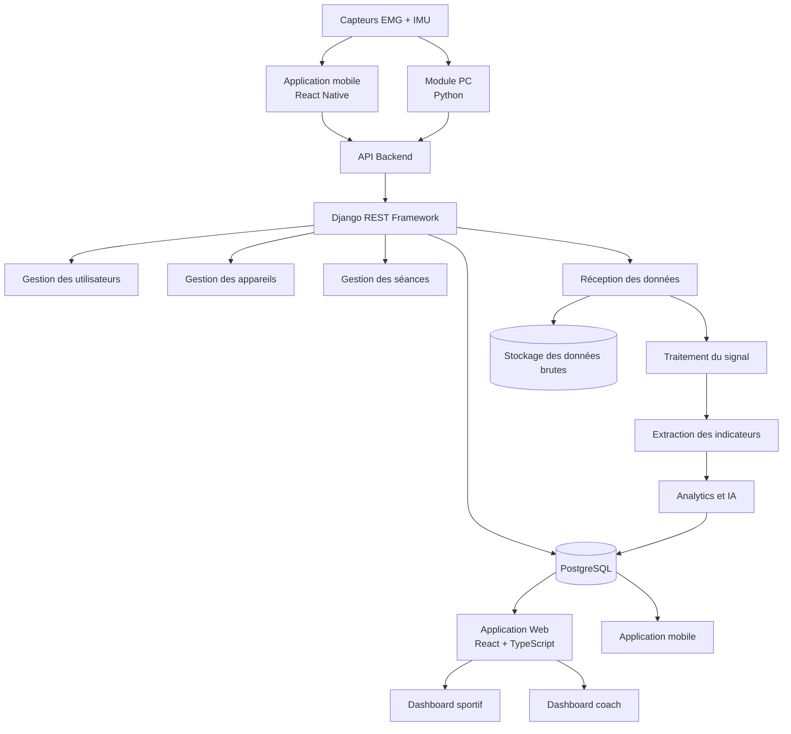
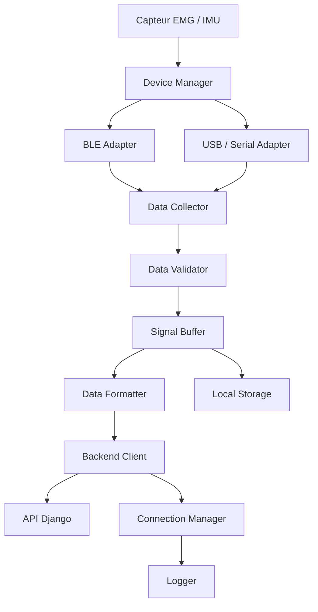
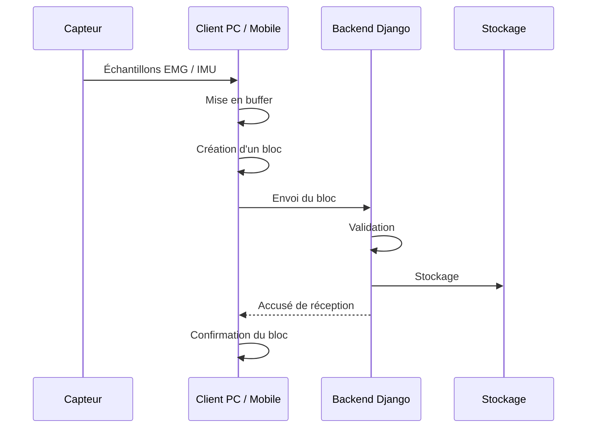
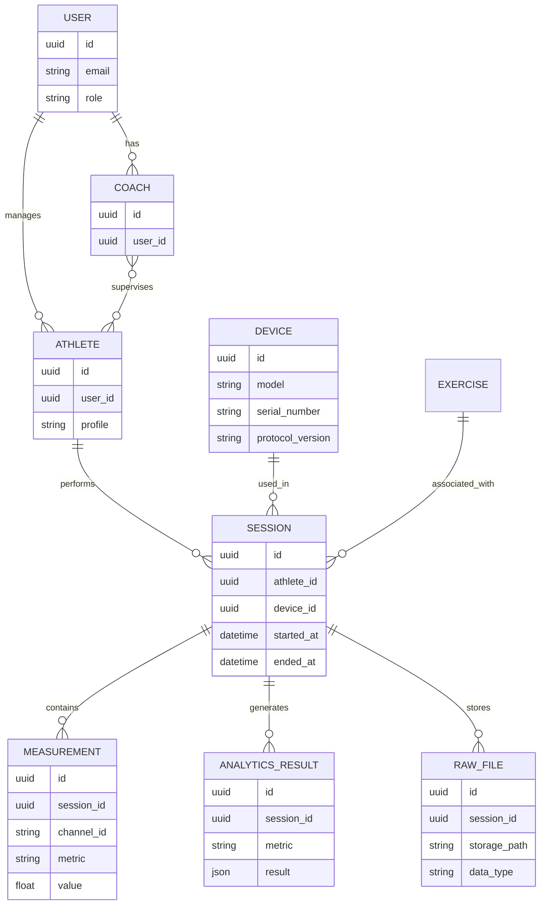
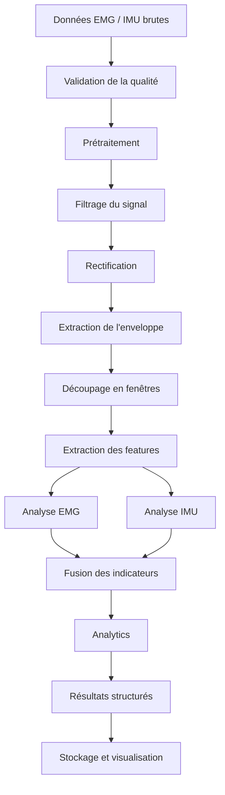
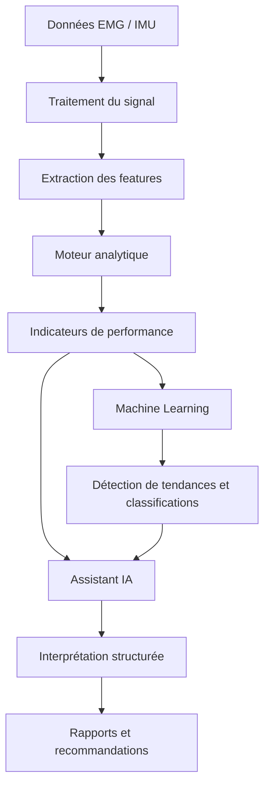
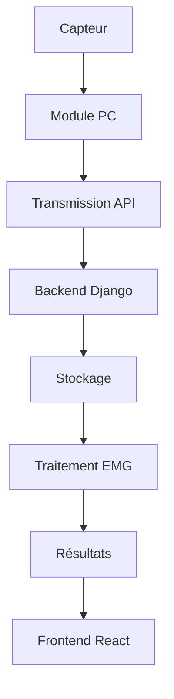
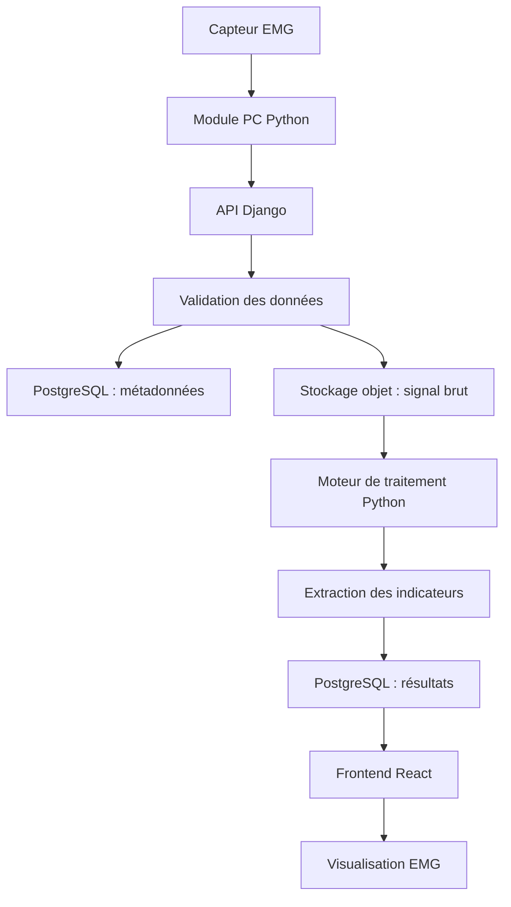
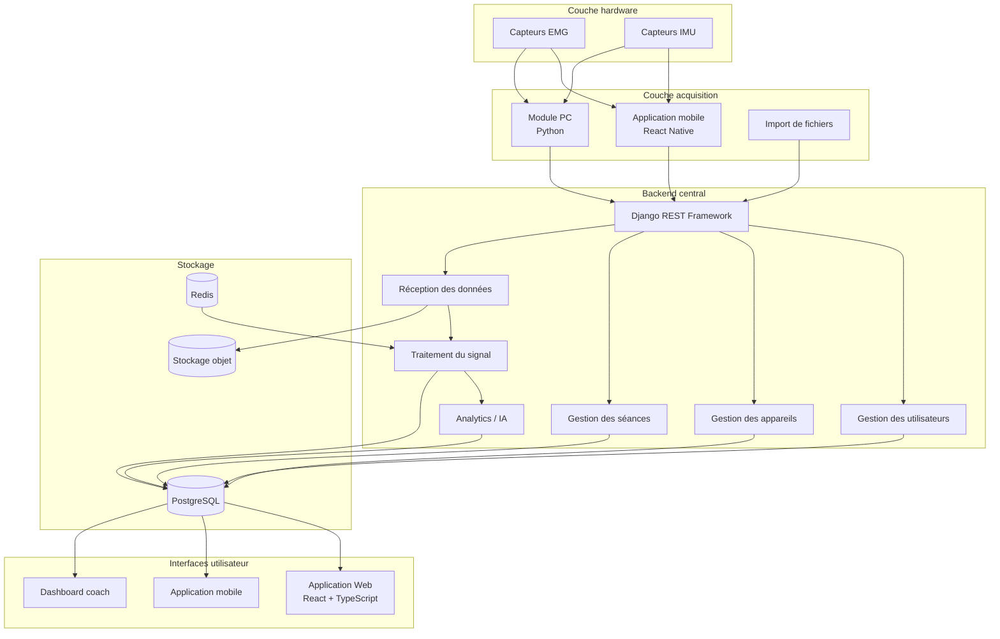

# Roadmap complète de développement logiciel — Plateforme EMG

## 1. Présentation générale du projet

Mon objectif est de développer une plateforme Sport-Tech dédiée à l'analyse musculaire et à l'optimisation de la performance sportive grâce à des capteurs EMG, IMU et à l'intelligence artificielle.

La plateforme sera composée de plusieurs éléments complémentaires :

- Des capteurs connectés permettant de mesurer l'activité musculaire et les mouvements.
- Une application mobile permettant de connecter les capteurs, de récupérer les données et de suivre les séances.
- Un module PC permettant de connecter directement les capteurs à un ordinateur et de transmettre les données au backend.
- Une application Web permettant de visualiser, analyser et exploiter les données.
- Un backend centralisant les utilisateurs, les appareils, les séances, les données et les traitements.
- Un moteur d'analyse et d'intelligence artificielle permettant d'interpréter les données musculaires et de produire des indicateurs utiles aux sportifs et aux coachs.

Je vais commencer par développer le backend et le frontend Web. En parallèle, je prévois de développer un premier module Python capable de récupérer les données du capteur depuis un ordinateur et de les envoyer au backend.

L'application mobile sera développée dans un second temps, mais son architecture sera anticipée dès le départ afin de ne pas avoir à modifier le backend lorsque je l'intégrerai.

Mon objectif est de construire une architecture évolutive, modulaire et suffisamment flexible pour pouvoir intégrer différents modèles de capteurs, sans dépendre d'un seul fabricant.

---

# 2. Choix technologiques

## 2.1. Backend


- **Django REST Framework (DRF)** : création des API REST.
- **PostgreSQL** : base de données relationnelle.
- **Redis** : gestion du cache et des tâches asynchrones.
- **Celery** : exécution des traitements en arrière-plan.
- **Django Channels** : communication WebSocket si nécessaire.
- **NumPy / SciPy** : traitement des signaux EMG et IMU.
- **Scikit-learn / PyTorch** : développement des modèles de machine learning.
- **OpenAPI / Swagger** : documentation des API.

Je vais commencer avec un monolithe Django modulaire plutôt qu'avec une architecture microservices. Cela me permettra de développer plus rapidement tout en conservant une séparation claire entre les différentes fonctionnalités.

### Frontend Web

- **React** : construction de l'interface utilisateur.
- **TypeScript** : typage et fiabilité du code.
- **Vite** : environnement de développement et build.
- **Tailwind CSS** : styling et mise en page de l'interface.
- **shadcn/ui** : composants React personnalisables (boutons, cartes, tableaux, menus, fenêtres modales, onglets, etc.).
- **React Router** : navigation entre les pages.
- **TanStack Query** : gestion des requêtes API et des données serveur.
- **Zustand** : gestion de l'état global de l'application.
- **Recharts** : graphiques et visualisation des données EMG/IMU.
- **React Hook Form** : gestion des formulaires.
- **Zod** : validation des données et des formulaires.

Tailwind CSS et shadcn/ui seront utilisés ensemble : Tailwind permettra de personnaliser le design, tandis que shadcn/ui fournira des composants réutilisables et personnalisables.

L'interface devra adopter une esthétique Sport-Tech premium : design moderne et minimaliste, mode sombre, sidebar de navigation, cartes statistiques, graphiques interactifs et dashboards de suivi des sportifs.


## 2.3. Application mobile

- **React Native** : développement de l'application mobile.
- **TypeScript** : langage de développement.
- **Expo** : environnement de développement.
- **Expo Router** : navigation.
- **TanStack Query** : communication avec le backend.
- **Zustand** : gestion de l'état local.
- **react-native-ble-plx** : communication Bluetooth Low Energy avec les capteurs.

Je prévois d'utiliser un Expo Development Build pour intégrer les fonctionnalités Bluetooth natives qui ne sont pas nécessairement disponibles dans Expo Go.

L'application mobile devra pouvoir fonctionner même lorsque la connexion Internet est temporairement indisponible.

## 2.4. Module PC

Je souhaite développer un logiciel relais installé directement sur l'ordinateur du coach ou de l'utilisateur.

Ce module sera développé principalement en **Python**.

Il aura pour mission de :

- Détecter les capteurs compatibles.
- Se connecter aux capteurs en Bluetooth Low Energy, USB ou port série selon le matériel.
- Récupérer les données EMG et IMU en continu.
- Organiser les données dans un format commun.
- Regrouper les échantillons en blocs.
- Transmettre les données au backend.
- Gérer les déconnexions et les reconnexions.
- Conserver temporairement les données en cas de coupure Internet.
- Fournir un retour sur l'état de la connexion et de la transmission.

Le module PC devra pouvoir être installé facilement par un coach, sans qu'il ait besoin de manipuler du code ou de configurer manuellement les communications avec le backend.

À terme, je pourrai fournir un installateur pour Windows et macOS.

## 2.5. Infrastructure et outils complémentaires

- **Docker** : environnement de développement et déploiement.
- **Docker Compose** : orchestration locale des services.
- **Nginx** : reverse proxy.
- **Git / GitHub** : gestion du code source.
- **GitHub Actions** : automatisation des tests et du déploiement.
- **Pytest** : tests backend et traitement du signal.
- **Jest / React Testing Library** : tests frontend.
- **Sentry** : suivi des erreurs.
- **S3 compatible / MinIO** : stockage des fichiers de données brutes.
- **Redis + Celery** : traitements asynchrones.

---

# 3. Architecture générale de la plateforme

Je veux que le backend soit le cœur central de toute la plateforme.

Les différentes interfaces et les différents systèmes d'acquisition communiqueront avec lui.

Il ne devra pas être nécessaire de développer un backend différent pour le téléphone et pour l'ordinateur.

L'application mobile et le module PC auront le même rôle d'acquisition et de transmission des données. Ils devront utiliser un protocole commun.

## 3.1. Schéma général



## 3.2. Principe fondamental : séparer acquisition et analyse

Je souhaite séparer clairement les responsabilités.

Les applications mobiles et le module PC seront responsables de la communication avec les capteurs et de la transmission des données.

Le backend sera responsable de la réception, de la validation, du stockage, de l'analyse et de la mise à disposition des résultats.

Cette séparation me permettra de changer de capteur ou de développer un nouveau client d'acquisition sans devoir modifier toute la plateforme.

Par exemple, je pourrai intégrer un nouveau capteur Bluetooth ou un capteur USB en développant uniquement un nouvel adaptateur dans le module d'acquisition concerné.

---

# 4. Architecture du système d'acquisition

Cette partie est particulièrement importante, car je souhaite que mon système soit compatible avec plusieurs sources de données.

Je prévois trois possibilités d'acquisition :

1. Connexion des capteurs à un smartphone.
2. Connexion directe des capteurs à un ordinateur avec le module PC.
3. Importation de fichiers de données pour les tests, les analyses ou l'intégration de nouveaux capteurs.

## 4.1. Acquisition depuis un smartphone

L'application React Native devra :

- Détecter les capteurs Bluetooth compatibles.
- Permettre de sélectionner un capteur.
- Établir une connexion BLE.
- Récupérer les données en continu.
- Organiser les données reçues.
- Afficher un aperçu du signal en temps réel.
- Enregistrer temporairement les données localement.
- Envoyer les données au backend par blocs.
- Gérer les pertes de connexion.

Le téléphone pourra également réaliser certains traitements simples en temps réel, notamment pour afficher un biofeedback avec une faible latence.

## 4.2. Acquisition depuis un ordinateur

Le module PC Python devra reproduire le même fonctionnement que l'application mobile pour la partie acquisition et transmission.

Le coach pourra installer le logiciel, connecter son capteur et utiliser directement son ordinateur pour effectuer une séance.

Le module devra fonctionner de manière indépendante du frontend Web.

Il ne sera donc pas nécessaire de garder une page Web ouverte pour que la récupération des données fonctionne.

Le module PC pourra fonctionner en arrière-plan et communiquer directement avec le backend.

Le coach utilisera ensuite l'application Web pour visualiser les données et analyser les résultats.

### Architecture du module PC



### Organisation interne du module PC

Je souhaite séparer le module en plusieurs composants :

| Composant | Responsabilité |
|---|---|
| Device Manager | Détecter et gérer les appareils |
| BLE Adapter | Gérer les connexions Bluetooth |
| USB / Serial Adapter | Gérer les connexions filaires |
| Data Collector | Récupérer les données du capteur |
| Data Validator | Vérifier la cohérence des données |
| Signal Buffer | Regrouper les échantillons |
| Data Formatter | Uniformiser les données |
| Backend Client | Communiquer avec l'API |
| Connection Manager | Gérer les connexions et reconnexions |
| Local Storage | Conserver temporairement les données |
| Logger | Enregistrer les événements et erreurs |

Je souhaite que chaque type de capteur soit intégré au moyen d'un adaptateur spécifique.

Cela permettra de conserver une architecture commune même si les protocoles de communication changent.

## 4.3. Acquisition par importation de fichiers

Je souhaite également prévoir la possibilité d'importer des fichiers CSV ou d'autres formats de données compatibles.

Cette fonctionnalité sera utile pour :

- Tester les algorithmes sans avoir systématiquement besoin du capteur.
- Analyser des données enregistrées précédemment.
- Comparer différents appareils.
- Développer le moteur de traitement du signal indépendamment du hardware.
- Importer des données issues d'autres systèmes lorsque leur format est documenté.

---

# 5. Protocole commun de transmission des données

Je souhaite définir un format de données standardisé qui sera utilisé par le module PC et l'application mobile.

Le backend ne devra pas dépendre de la provenance des données.

Chaque bloc transmis devra contenir les informations nécessaires pour identifier le capteur, la séance, les canaux et les échantillons.

## 5.1. Informations principales

| Champ | Description |
|---|---|
| device_id | Identifiant du capteur |
| session_id | Identifiant de la séance |
| channel_id | Identifiant du canal musculaire |
| timestamp | Horodatage des données |
| sequence_number | Numéro de séquence du bloc |
| sample_rate | Fréquence d'échantillonnage |
| data_type | Type de signal |
| units | Unité ou échelle de mesure |
| samples | Liste des échantillons |
| calibration | Informations de calibration |
| metadata | Informations complémentaires |

## 5.2. Exemple de structure JSON

```json
{
  "session_id": "session_123",
  "device_id": "device_001",
  "sequence_number": 42,
  "timestamp": "2026-11-03T18:30:00Z",
  "data_type": "emg_raw",
  "sample_rate": 1000,
  "channels": [
    {
      "channel_id": "channel_01",
      "muscle": "biceps",
      "units": "raw",
      "samples": [120, 125, 132, 118, 110]
    }
  ],
  "metadata": {
    "source": "pc",
    "connection_type": "ble",
    "device_model": "prototype_v1"
  }
}
```

Cet exemple est une structure indicative. Je devrai adapter les champs aux capacités réelles de mes capteurs et à leur protocole de communication.

Je souhaite notamment conserver :

- Le timestamp de chaque bloc et, si nécessaire, les timestamps individuels des échantillons.
- Le numéro de séquence pour détecter les blocs manquants.
- La fréquence d'échantillonnage réelle.
- Les informations de calibration.
- Le modèle du capteur.
- La version du protocole utilisé.

Je devrai également distinguer les timestamps de réception et les timestamps d'acquisition. La synchronisation temporelle est importante pour comparer les signaux EMG et IMU.

## 5.3. Transmission par blocs

Je ne souhaite pas envoyer chaque échantillon individuellement au backend.

Les données seront regroupées en blocs, par exemple toutes les 100 à 500 millisecondes selon la fréquence d'acquisition et les contraintes du capteur.



Je souhaite prévoir un mécanisme de reprise après erreur.

Si Internet est coupé, les blocs devront être conservés localement et transmis lorsque la connexion sera rétablie.

Le système devra éviter les doublons grâce à des identifiants uniques et aux numéros de séquence.

Je devrai également surveiller les pertes de paquets entre le capteur et le client d'acquisition, car un bloc transmis correctement au backend ne garantit pas que tous les échantillons ont été récupérés depuis le capteur.

---

# 6. Architecture du backend Django

Le backend sera le centre de gestion de la plateforme.

Je souhaite utiliser Django avec Django REST Framework pour construire une API versionnée.

Toutes les fonctionnalités principales seront organisées en applications Django indépendantes.

## 6.1. Organisation des applications backend

| Application Django | Responsabilité |
|---|---|
| accounts | Authentification et utilisateurs |
| athletes | Gestion des sportifs |
| coaches | Gestion des coachs |
| teams | Gestion des équipes et groupes |
| devices | Gestion des capteurs |
| exercises | Gestion des exercices |
| workouts | Gestion des entraînements |
| sessions | Gestion des séances |
| measurements | Gestion des mesures |
| signal_processing | Traitement des signaux |
| analytics | Calcul des indicateurs |
| ai_engine | Intelligence artificielle |
| reports | Rapports et exports |
| notifications | Notifications |
| subscriptions | Abonnements et facturation |
| audit | Historique des actions importantes |

Je souhaite garder une séparation claire entre les modèles, les services, les API, les tâches asynchrones et les tests.

## 6.2. Structure du backend

```text
backend/
│
├── config/
│   ├── settings/
│   │   ├── base.py
│   │   ├── development.py
│   │   ├── production.py
│   │   └── testing.py
│   ├── urls.py
│   ├── asgi.py
│   └── wsgi.py
│
├── apps/
│   ├── accounts/
│   ├── athletes/
│   ├── coaches/
│   ├── teams/
│   ├── devices/
│   ├── exercises/
│   ├── workouts/
│   ├── sessions/
│   ├── measurements/
│   ├── signal_processing/
│   ├── analytics/
│   ├── ai_engine/
│   ├── reports/
│   ├── notifications/
│   ├── subscriptions/
│   └── audit/
│
├── tests/
├── requirements/
│   ├── base.txt
│   ├── development.txt
│   └── production.txt
│
├── manage.py
└── Dockerfile
```

Chaque application pourra contenir ses propres :

```text
models.py
serializers.py
views.py
urls.py
services.py
permissions.py
tasks.py
tests/
```

Je ne souhaite pas placer toute la logique métier dans les vues Django.

Les vues devront principalement recevoir les requêtes, valider les entrées et appeler les services correspondants.

## 6.3. API REST

Je souhaite versionner toutes mes API dès le départ.

Exemple :

```text
/api/v1/
```

Quelques routes principales :

| Méthode | Endpoint | Fonction |
|---|---|---|
| POST | /api/v1/auth/register/ | Inscription |
| POST | /api/v1/auth/login/ | Connexion |
| GET | /api/v1/users/me/ | Profil utilisateur |
| GET | /api/v1/athletes/ | Liste des sportifs |
| POST | /api/v1/athletes/ | Création d'un sportif |
| GET | /api/v1/devices/ | Liste des appareils |
| POST | /api/v1/devices/ | Enregistrement d'un appareil |
| GET | /api/v1/exercises/ | Liste des exercices |
| POST | /api/v1/sessions/ | Création d'une séance |
| POST | /api/v1/sessions/{id}/data/ | Transmission des blocs de données |
| POST | /api/v1/sessions/{id}/complete/ | Fin d'une séance |
| GET | /api/v1/sessions/{id}/ | Détails d'une séance |
| GET | /api/v1/analytics/{id}/ | Résultats d'analyse |
| GET | /api/v1/reports/{id}/ | Rapport d'une séance |

Les routes définitives seront adaptées au fur et à mesure du développement.

Je souhaite également mettre en place une documentation OpenAPI/Swagger afin de pouvoir tester les endpoints et faciliter le développement des clients mobiles et PC.

## 6.4. Gestion des utilisateurs et des permissions

## 6.4. Gestion des utilisateurs et des permissions

Je souhaite prévoir plusieurs profils d'utilisation afin que la plateforme puisse répondre aussi bien aux besoins des sportifs individuels qu'à ceux des coachs et des structures sportives.

Les profils prévus sont :

- **Administrateur** : gestion globale de la plateforme, des utilisateurs, des abonnements et des permissions.
- **Utilisateur individuel** : personne souhaitant utiliser le service de manière autonome, sans coach ni structure sportive. Elle pourra gérer ses appareils, réaliser ses propres séances, consulter ses mesures EMG/IMU, suivre ses performances et accéder aux fonctionnalités correspondant à son abonnement.
- **Sportif** : utilisateur dont le suivi est également assuré par un ou plusieurs coachs ou structures sportives.
- **Coach** : professionnel pouvant gérer plusieurs sportifs, consulter leurs données avec leur autorisation et suivre leur progression.
- **Structure sportive ou équipe** : organisation regroupant plusieurs coachs et sportifs, avec une gestion centralisée des utilisateurs et des données selon les permissions accordées.

Un utilisateur individuel pourra, à tout moment, décider de rejoindre une équipe ou d'autoriser un coach à accéder à certaines de ses données, sans devoir créer un nouveau compte.

Un coach pourra gérer plusieurs sportifs.

Un sportif pourra éventuellement être rattaché à plusieurs coachs ou structures selon les règles d'accès définies.

Je devrai prévoir un système de permissions précis pour garantir que :
- Chaque utilisateur puisse accéder à ses propres données.
- Un coach ne puisse consulter les données d'un sportif qu'avec son autorisation.
- Une structure ne puisse accéder qu'aux données auxquelles elle a été explicitement autorisée.
- Les droits d'accès puissent être modifiés ou révoqués.
- Les données personnelles et les séances restent privées par défaut.

L'objectif est de proposer deux expériences complémentaires : une utilisation individuelle, simple et autonome, et une utilisation collaborative destinée aux coachs, équipes et structures sportives.

---

# 7. Architecture de la base de données PostgreSQL

Je vais utiliser PostgreSQL pour gérer les données structurées de la plateforme.

Je souhaite éviter de stocker chaque échantillon EMG sous forme de ligne dans PostgreSQL. Avec des fréquences d'échantillonnage élevées, cela produirait rapidement un volume de données important et compliquerait les requêtes.

Je vais donc séparer les données structurées des fichiers de signaux bruts.

## 7.1. Répartition du stockage

## 7.1. Répartition du stockage

Je vais commencer avec PostgreSQL pour les données structurées et le stockage local sur le serveur Linux pour les fichiers volumineux.

| Type de données | Stockage |
|---|---|
| Utilisateurs | PostgreSQL |
| Sportifs | PostgreSQL |
| Coachs | PostgreSQL |
| Appareils | PostgreSQL |
| Exercices | PostgreSQL |
| Séances | PostgreSQL |
| Métadonnées des signaux | PostgreSQL |
| Signaux EMG bruts | Stockage local Linux |
| Signaux IMU bruts | Stockage local Linux |
| Données filtrées | Stockage local Linux si volumineuses |
| Indicateurs calculés | PostgreSQL |
| Résultats IA | PostgreSQL |
| Rapports | Stockage local Linux ou PostgreSQL selon le format |

Les fichiers seront organisés dans une arborescence dédiée sur le serveur Linux, avec une séparation entre les données brutes, les données traitées et les rapports.

PostgreSQL conservera les métadonnées et les chemins permettant de retrouver les fichiers associés à chaque séance.

Cette solution sera utilisée pendant le développement et les premières phases du projet. L'architecture devra toutefois permettre de migrer ultérieurement vers un stockage objet compatible S3 ou MinIO sans modifier le fonctionnement général de l'application.

## 7.2. Modèle conceptuel simplifié



Ce schéma est volontairement simplifié. Je détaillerai les relations, les contraintes et les index lors de la conception de la base de données.

Je souhaite utiliser des UUID pour les identifiants des principales entités.

---

# 8. Traitement des signaux EMG et IMU

Le traitement du signal sera l'un des éléments les plus importants de la plateforme.

Je souhaite construire un moteur Python indépendant de Django afin de pouvoir l'utiliser dans différents contextes :

- Traitement des données reçues par le backend.
- Tests sur des fichiers CSV.
- Développement des algorithmes.
- Analyses expérimentales.
- Traitements asynchrones avec Celery.

Je ne souhaite pas mélanger les algorithmes scientifiques avec les vues et les endpoints Django.

## 8.1. Architecture du moteur de traitement



## 8.2. Prétraitement EMG

Je souhaite commencer par développer les fonctionnalités suivantes :

- Vérification de la qualité du signal.
- Détection des données manquantes.
- Détection des saturations.
- Vérification de la fréquence d'échantillonnage.
- Filtrage passe-bande adapté au capteur et au protocole.
- Filtrage Notch à 50 Hz si nécessaire.
- Rectification du signal.
- Calcul de l'enveloppe.
- Calcul du RMS.

Les paramètres de filtrage devront être configurables et documentés.

Je devrai également vérifier la nature exacte du signal fourni par chaque capteur.

Par exemple, un capteur peut fournir un signal RAW, un signal rectifié ou une enveloppe déjà calculée. Je ne devrai pas appliquer automatiquement les mêmes traitements à toutes les sorties.

## 8.3. Extraction des indicateurs EMG

Je souhaite calculer plusieurs indicateurs :

| Indicateur | Utilité |
|---|---|
| RMS | Niveau moyen de l'activité musculaire |
| MAV | Valeur absolue moyenne |
| iEMG | Activité musculaire intégrée |
| Peak | Amplitude maximale |
| Mean Frequency | Fréquence moyenne |
| Median Frequency | Fréquence médiane |
| Zero Crossing | Nombre de changements de signe |
| Waveform Length | Complexité et variation du signal |
| Activation Duration | Durée d'activation |
| Activation Ratio | Rapport entre périodes actives et inactives |

Ces indicateurs seront calculés sur des fenêtres temporelles adaptées à l'analyse.

Je souhaite conserver les résultats avec les paramètres utilisés afin de pouvoir reproduire une analyse ultérieurement.

## 8.4. Traitement IMU

Les capteurs IMU permettront d'ajouter une dimension biomécanique à l'analyse musculaire.

Je souhaite exploiter :

- L'accélération.
- La vitesse angulaire.
- L'orientation lorsque le capteur le permet.
- La détection des répétitions.
- La segmentation des mouvements.
- La détection des phases concentriques et excentriques lorsque cela est pertinent.
- La durée des phases de mouvement.
- Les variations de vitesse.
- La régularité du mouvement.

La combinaison EMG + IMU permettra de mieux comprendre l'activité musculaire en fonction du mouvement réalisé.

## 8.5. Normalisation et calibration

Je souhaite prévoir des procédures de calibration.

Cela pourra notamment inclure une normalisation par rapport à une contraction volontaire maximale (MVC), lorsque le protocole expérimental est adapté.

Je devrai toutefois faire attention aux comparaisons entre séances, entre muscles ou entre côtés du corps.

Le placement des électrodes, la préparation de la peau, la posture, le capteur, la calibration et les conditions de mesure peuvent fortement influencer les résultats.

Je ne devrai donc pas interpréter automatiquement une différence d'amplitude comme une différence réelle de performance musculaire.

## 8.6. Traçabilité des traitements

Pour chaque analyse, je souhaite conserver :

- La version de l'algorithme.
- Les paramètres de filtrage.
- La fréquence d'échantillonnage.
- Le modèle du capteur.
- Les informations de calibration.
- La version du protocole d'acquisition.
- La date du traitement.
- La version du modèle IA, si un modèle est utilisé.

Cela me permettra de comparer les résultats dans le temps et de comprendre précisément comment chaque indicateur a été calculé.

---

# 9. Développement du frontend Web

Le frontend Web sera développé avec React et TypeScript.

Je souhaite commencer par une interface fonctionnelle permettant de gérer les utilisateurs, les sportifs, les appareils et les séances.

Ensuite, je développerai progressivement les outils de visualisation et d'analyse.

## 9.1. Organisation du frontend

```text
frontend/
└── web/
    ├── public/
    ├── src/
    │   ├── components/
    │   ├── pages/
    │   ├── layouts/
    │   ├── features/
    │   │   ├── authentication/
    │   │   ├── dashboard/
    │   │   ├── athletes/
    │   │   ├── coaches/
    │   │   ├── devices/
    │   │   ├── exercises/
    │   │   ├── workouts/
    │   │   ├── sessions/
    │   │   ├── analytics/
    │   │   └── reports/
    │   ├── services/
    │   ├── hooks/
    │   ├── stores/
    │   ├── types/
    │   ├── utils/
    │   └── main.tsx
    │
    ├── package.json
    └── vite.config.ts
```

Je souhaite organiser le frontend par fonctionnalités afin de pouvoir développer chaque partie indépendamment.

## 9.2. Fonctionnalités principales

### Authentification

- Inscription.
- Connexion.
- Déconnexion.
- Récupération du mot de passe.
- Gestion du profil.
- Gestion des rôles et permissions.

### Dashboard principal

- Vue d'ensemble de l'activité.
- Nombre de séances.
- Dernières séances réalisées.
- Indicateurs de performance.
- Progression générale.

### Gestion des sportifs

- Création d'un profil sportif.
- Modification des informations.
- Historique des séances.
- Association avec un coach.
- Consultation des résultats.

### Gestion des appareils

- Enregistrement des capteurs.
- Identification des appareils.
- Association des capteurs aux utilisateurs.
- Consultation des informations techniques.
- Historique d'utilisation.

### Gestion des exercices

- Bibliothèque d'exercices.
- Description des mouvements.
- Groupes musculaires concernés.
- Paramètres de séance.
- Association avec les analyses.

### Gestion des séances

- Création d'une séance.
- Sélection du sportif.
- Sélection de l'exercice.
- Association du capteur.
- Consultation des données enregistrées.
- Historique des séances.

## 9.3. Visualisation des signaux

Je souhaite développer des graphiques permettant de visualiser les données EMG et IMU.

L'interface devra notamment afficher :

- Le signal EMG brut.
- Le signal filtré.
- L'enveloppe EMG.
- Les indicateurs RMS.
- Les phases d'activation.
- Les répétitions détectées.
- Les données IMU.
- Les résultats calculés.

Je souhaite pouvoir sélectionner une période du signal, zoomer, comparer des canaux et consulter les indicateurs associés.

Je devrai distinguer la visualisation en temps réel de l'analyse après séance. Les deux n'ont pas les mêmes exigences techniques.

---

# 10. Développement de l'application mobile

Même si je vais commencer par le backend et le frontend Web, je souhaite anticiper l'application mobile dès la conception.

Elle sera développée avec React Native et TypeScript.

Elle aura deux rôles principaux :

1. Permettre de récupérer les données des capteurs.
2. Permettre au sportif de suivre ses séances et ses résultats.

## 10.1. Fonctionnalités principales

- Création de compte et connexion.
- Gestion du profil sportif.
- Détection des capteurs BLE.
- Connexion et déconnexion des capteurs.
- Vérification de la qualité de connexion.
- Visualisation du signal en direct.
- Création d'une séance.
- Enregistrement des données.
- Biofeedback en temps réel.
- Consultation des résultats.
- Historique des entraînements.
- Synchronisation avec le backend.

## 10.2. Fonctionnement hors ligne

Je souhaite que l'application puisse fonctionner même sans connexion Internet.

Elle devra pouvoir :

- Enregistrer les données localement.
- Conserver les métadonnées de la séance.
- Mettre les blocs en attente.
- Reprendre automatiquement la synchronisation.
- Éviter les doublons.
- Signaler les erreurs de transmission.

Le stockage local devra être suffisamment fiable pour ne pas perdre les données lors d'une interruption de l'application.

---

# 11. Développement de l'intelligence artificielle et des analytics

Je souhaite développer progressivement un moteur d'analyse qui transformera les données EMG et IMU en informations utiles aux sportifs et aux coachs.

Je ne souhaite pas commencer par une IA générative qui interpréterait directement des signaux bruts.

Je vais d'abord développer des algorithmes déterministes et des indicateurs fiables, puis ajouter du machine learning et, éventuellement, un assistant conversationnel.

## 11.1. Architecture de l'analyse



L'assistant IA recevra des résultats structurés et contextualisés, et non des milliers d'échantillons bruts.

Je souhaite qu'il puisse expliquer les résultats en langage naturel, tout en s'appuyant sur des indicateurs calculés et vérifiables.

## 11.2. Fonctionnalités analytiques envisagées

### Muscle Analysis

Analyse de l'activité musculaire :

- Niveau d'activation.
- Durée d'activation.
- Intensité relative.
- Évolution pendant une répétition.
- Comparaison entre différentes séances.

### Movement Analysis

Analyse du mouvement :

- Détection des répétitions.
- Segmentation des phases du mouvement.
- Synchronisation EMG / IMU.
- Évolution de la vitesse.
- Régularité des répétitions.

### Fatigue Detection

Analyse d'indicateurs pouvant être associés à une évolution de la fatigue :

- Évolution de la fréquence médiane.
- Évolution de l'amplitude.
- Modifications des profils d'activation.
- Évolution de la vitesse du mouvement.
- Comparaison entre le début et la fin d'une séance.

Je devrai présenter ces résultats comme des indicateurs indirects et non comme une mesure directe de la fatigue physiologique.

### Muscle Balance

Analyse de la répartition de l'activité musculaire :

- Comparaison gauche / droite.
- Comparaison entre groupes musculaires.
- Comparaison entre répétitions.
- Détection de différences persistantes.

Ces comparaisons devront être accompagnées de conditions de mesure et de calibration adaptées.

### Training Optimization

Analyse des entraînements :

- Suivi de l'évolution de l'activité musculaire.
- Comparaison des séances.
- Analyse de la régularité.
- Identification de tendances.
- Aide à l'ajustement de l'entraînement.

### Progress Tracking

Suivi de progression :

- Historique des indicateurs.
- Graphiques d'évolution.
- Comparaison entre périodes.
- Comparaison entre exercices.
- Suivi des objectifs.

## 11.3. Assistant conversationnel

Je souhaite éventuellement intégrer un assistant IA permettant au sportif ou au coach de poser des questions sur les résultats.

Exemples :

- Quels muscles ont été les plus sollicités pendant cette séance ?
- Comment mon activité musculaire a-t-elle évolué ?
- Est-ce que mes résultats sont différents de ceux de la semaine dernière ?
- Quelles tendances observes-tu sur mes dernières séances ?
- Comment évolue mon asymétrie mesurée dans ces conditions ?

L'assistant devra uniquement exploiter les données auxquelles l'utilisateur est autorisé à accéder.

Il devra également pouvoir indiquer lorsqu'une analyse est incertaine ou lorsque les données sont insuffisantes.

Je souhaite éviter les recommandations non justifiées et les interprétations médicales.

---

# 12. Espace coach et modèle B2B

Je souhaite développer une interface dédiée aux coachs et aux structures sportives.

Cet espace sera particulièrement intéressant pour les professionnels qui utiliseront les capteurs directement depuis leur ordinateur.

## 12.1. Fonctionnalités coach

- Création d'un compte coach.
- Gestion de plusieurs sportifs.
- Création de groupes ou d'équipes.
- Association des sportifs.
- Consultation des séances.
- Analyse des résultats.
- Comparaison des performances.
- Historique des entraînements.
- Création de rapports.
- Suivi de la progression.

## 12.2. Utilisation avec le module PC

Le scénario d'utilisation sera le suivant :

1. Le coach installe le module PC.
2. Il connecte les capteurs à son ordinateur.
3. Il ouvre le module et se connecte à son compte.
4. Il sélectionne le sportif concerné.
5. Il démarre une séance.
6. Le module récupère les données des capteurs.
7. Les données sont transmises au backend.
8. Le backend traite et stocke les informations.
9. Le coach consulte les résultats depuis l'application Web.

Le module PC et le frontend Web resteront indépendants, mais ils utiliseront le même compte et les mêmes données.

---

# 13. Sécurité, confidentialité et fiabilité

La plateforme va manipuler des données personnelles liées à la performance physique.

Selon leur nature et leur utilisation, certaines données pourront également relever de la réglementation applicable aux données de santé.

Je souhaite donc intégrer la sécurité et la confidentialité dès la conception.

## 13.1. Sécurité des comptes

- Authentification sécurisée.
- Gestion des sessions.
- Gestion des permissions.
- Protection des endpoints.
- Politique de mots de passe.
- Gestion des accès coach / sportif.
- Journalisation des actions importantes.

## 13.2. Sécurité des communications

- HTTPS obligatoire en production.
- Authentification des clients PC et mobile.
- Vérification des droits avant réception des données.
- Validation des données entrantes.
- Protection contre les requêtes malveillantes.
- Gestion des jetons d'accès et de renouvellement.

Le module PC devra utiliser une authentification adaptée à un logiciel installé sur un ordinateur. Il ne devra pas contenir de clé secrète globale partagée entre tous les utilisateurs.

## 13.3. Confidentialité des données

Je souhaite prévoir :

- Consentement et information des utilisateurs.
- Gestion des autorisations de partage.
- Séparation des données entre utilisateurs.
- Gestion des droits d'accès des coachs.
- Export des données.
- Suppression des données lorsque cela est demandé et applicable.
- Politique de conservation.
- Chiffrement des données en transit et au repos.
- Sauvegardes régulières.

Je devrai également tenir compte du RGPD et documenter les traitements de données.

## 13.4. Fiabilité

Je souhaite prévoir des mécanismes pour :

- Détecter les pertes de données.
- Détecter les erreurs de transmission.
- Éviter les doublons.
- Reprendre les transmissions interrompues.
- Contrôler la qualité des signaux.
- Conserver les logs techniques.
- Surveiller les erreurs du backend.

---

# 14. Tests et validation

Je souhaite développer une stratégie de tests dès le début du projet.

## 14.1. Tests backend

Avec Pytest, je souhaite tester :

- Les modèles.
- Les serializers.
- Les endpoints.
- Les permissions.
- L'authentification.
- La réception des données.
- Le stockage.
- Les traitements asynchrones.
- Les règles métier.

## 14.2. Tests frontend

Avec Jest et React Testing Library :

- Les composants.
- Les formulaires.
- Les pages.
- Les appels API.
- Les états de chargement.
- Les erreurs.
- Les permissions.
- Les parcours utilisateur.

## 14.3. Tests du module PC

Je souhaite tester :

- La détection des capteurs.
- La connexion BLE.
- La communication USB / série.
- La récupération des données.
- La validation des blocs.
- La gestion du buffer.
- La reconnexion automatique.
- Le stockage local.
- La synchronisation avec le backend.
- La détection des pertes de données.

## 14.4. Tests d'intégration

Je souhaite notamment tester le parcours complet :



Je souhaite pouvoir effectuer ce test avec un vrai capteur, mais également avec un simulateur de données afin de ne pas dépendre systématiquement du hardware pendant le développement.

---

# 15. Organisation générale du repository

Je souhaite utiliser un monorepo afin de centraliser les différents composants logiciels dans un seul repository Git.

Cela facilitera la gestion des versions et la coordination entre les différentes parties du projet.

```text
emg-platform/
│
├── backend/
│   ├── config/
│   ├── apps/
│   ├── tests/
│   ├── requirements/
│   └── manage.py
│
├── frontend/
│   └── web/
│       ├── public/
│       ├── src/
│       └── package.json
│
├── mobile/
│   └── app/
│       ├── src/
│       └── package.json
│
├── desktop/
│   └── pc-agent/
│       ├── app/
│       │   ├── adapters/
│       │   ├── devices/
│       │   ├── collector/
│       │   ├── buffer/
│       │   ├── transport/
│       │   ├── storage/
│       │   ├── authentication/
│       │   └── monitoring/
│       ├── tests/
│       ├── requirements/
│       └── main.py
│
├── shared/
│   ├── schemas/
│   ├── protocol/
│   └── documentation/
│
├── infrastructure/
│   ├── docker/
│   ├── nginx/
│   └── deployment/
│
├── documentation/
│   ├── architecture/
│   ├── api/
│   ├── database/
│   ├── acquisition-protocol/
│   └── signal-processing/
│
├── scripts/
│   ├── data_simulator/
│   └── development/
│
├── docker-compose.yml
└── README.md
```

Je souhaite que le dossier `shared` contienne les spécifications communes du protocole d'acquisition et les schémas de données.

Les différentes applications pourront implémenter ces spécifications dans leur langage respectif.

Le module PC utilisera Python, tandis que les applications Web et mobile utiliseront TypeScript.

---

# 16. Architecture de communication et de temps réel

Je souhaite distinguer deux types de communication.

### Communication d'acquisition

Elle concerne la transmission des données EMG et IMU depuis le téléphone ou le PC vers le backend.

Elle se fera principalement par API HTTP avec transmission de blocs.

### Communication temps réel

Elle concerne notamment :

- Les mises à jour de l'état d'une séance.
- Les événements de connexion.
- Les notifications.
- La visualisation des résultats disponibles.
- Les informations de progression d'un traitement.

Je pourrai utiliser Django Channels et WebSocket pour ces fonctionnalités.

Je ne souhaite pas utiliser WebSocket automatiquement pour transmettre chaque échantillon brut. Le choix du protocole d'acquisition devra être validé selon les débits, la latence, la fiabilité et les besoins réels.

Exemple de route WebSocket :

```text
/ws/sessions/{session_id}/
```

---

# 17. Roadmap de développement

Je souhaite développer le projet progressivement en commençant par les fondations du backend et du frontend Web.

Le module PC sera développé dès que le protocole d'acquisition et les premières API seront définis.

L'application mobile sera intégrée dans une phase ultérieure, mais le backend sera conçu dès le départ pour l'accueillir.

Les durées ci-dessous sont indicatives. Elles dépendront du temps de développement disponible, des difficultés liées au hardware et des résultats des tests.

## Phase 1 — Initialisation et architecture du projet

**Durée indicative : semaines 1 à 2**

Objectif : mettre en place les fondations techniques.

Tâches :

- Créer le repository Git.
- Mettre en place le monorepo.
- Initialiser Django.
- Initialiser React + TypeScript + Vite.
- Préparer la structure du module PC Python.
- Configurer PostgreSQL.
- Configurer Docker et Docker Compose.
- Préparer les environnements de développement.
- Configurer les variables d'environnement.
- Préparer les premières conventions de code.
- Définir la stratégie de tests.
- Documenter l'architecture générale.

Livrable :

Une architecture de projet fonctionnelle avec les différents environnements capables de démarrer.

## Phase 2 — Authentification et gestion des utilisateurs

**Durée indicative : semaines 3 à 4**

Objectif : mettre en place les comptes et les permissions.

Tâches backend :

- Créer l'application accounts.
- Définir le modèle utilisateur personnalisé.
- Mettre en place l'inscription.
- Mettre en place la connexion.
- Gérer les jetons d'accès.
- Gérer les permissions.
- Créer les endpoints du profil utilisateur.

Tâches frontend :

- Créer les pages d'inscription.
- Créer la page de connexion.
- Créer la gestion de session.
- Créer les routes protégées.
- Créer le profil utilisateur.

Livrable :

Un utilisateur peut créer un compte, se connecter et accéder à son espace personnel.

## Phase 3 — Gestion des sportifs, coachs, appareils et exercices

**Durée indicative : semaines 5 à 6**

Objectif : construire les principales entités métier.

Tâches :

- Créer l'application athletes.
- Créer l'application coaches.
- Créer l'application teams.
- Créer l'application devices.
- Créer l'application exercises.
- Créer l'application workouts.
- Définir les relations PostgreSQL.
- Créer les serializers et les endpoints.
- Mettre en place les permissions.
- Développer les premières interfaces Web de gestion.

Livrable :

Je peux gérer les utilisateurs, les sportifs, les coachs, les appareils et les exercices depuis le backend et l'application Web.

## Phase 4 — Gestion des séances et protocole d'acquisition

**Durée indicative : semaines 7 à 9**

Objectif : construire le système qui permettra de recevoir les données des capteurs.

Tâches :

- Créer l'application sessions.
- Définir le modèle de séance.
- Définir les métadonnées d'acquisition.
- Définir le format commun JSON.
- Définir les numéros de séquence.
- Définir les règles de validation.
- Créer les endpoints de réception.
- Préparer le stockage objet.
- Prévoir les mécanismes anti-doublons.
- Préparer les accusés de réception.
- Développer un simulateur de données EMG.
- Tester la réception de blocs de données.

Livrable :

Le backend peut créer une séance et recevoir des blocs de données EMG simulées ou réelles.

## Phase 5 — Développement du module PC

**Durée indicative : semaines 9 à 12**

Objectif : récupérer les données d'un capteur directement depuis un ordinateur et les transmettre au backend.

Tâches :

- Créer le Device Manager.
- Développer le premier adaptateur correspondant au capteur disponible.
- Développer la connexion BLE ou USB selon le matériel.
- Récupérer les données du capteur.
- Développer le Data Collector.
- Développer le Signal Buffer.
- Uniformiser les données.
- Développer le Backend Client.
- Gérer l'authentification.
- Envoyer les blocs à l'API.
- Gérer les accusés de réception.
- Gérer les pertes de connexion.
- Prévoir un stockage local temporaire.
- Ajouter les logs.
- Tester la transmission complète.

Livrable :

Un premier module PC fonctionnel permettant de connecter un capteur, de récupérer ses données et de les transmettre au backend.

## Phase 6 — Traitement des signaux EMG

**Durée indicative : semaines 11 à 14**

Objectif : transformer les données brutes en indicateurs exploitables.

Tâches :

- Créer le moteur Python indépendant.
- Développer la validation du signal.
- Développer les filtres.
- Développer la rectification.
- Développer le calcul de l'enveloppe.
- Développer le RMS.
- Développer les autres features.
- Préparer le traitement des signaux IMU.
- Développer les tests scientifiques.
- Sauvegarder les résultats.
- Enregistrer la version des algorithmes.

Livrable :

Le backend peut traiter les signaux reçus et produire des indicateurs EMG et IMU.

## Phase 7 — Dashboard et visualisation Web

**Durée indicative : semaines 13 à 17**

Objectif : permettre de consulter les données et les résultats.

Tâches :

- Développer le dashboard principal.
- Développer les pages sportifs.
- Développer les pages appareils.
- Développer les pages exercices.
- Développer les pages séances.
- Développer les graphiques EMG.
- Développer la visualisation des signaux filtrés.
- Afficher les indicateurs calculés.
- Ajouter les filtres et les comparaisons.
- Préparer les rapports.

Livrable :

Une application Web permettant de consulter les séances et d'analyser les données EMG.

## Phase 8 — Développement de l'application mobile

**Durée indicative : semaines 17 à 21**

Objectif : permettre l'acquisition des données directement depuis un smartphone.

Tâches :

- Initialiser React Native.
- Configurer Expo Development Build.
- Développer l'authentification.
- Développer la détection BLE.
- Développer la connexion aux capteurs.
- Récupérer les données.
- Développer le buffer local.
- Développer la visualisation du signal.
- Développer l'enregistrement des séances.
- Développer la synchronisation avec le backend.
- Gérer le fonctionnement hors ligne.
- Tester avec les capteurs réels.

Livrable :

Une première application mobile capable de connecter un capteur et de transmettre les données au backend.

## Phase 9 — Analytics et intelligence artificielle

**Durée indicative : semaines 21 à 26**

Objectif : développer les premières fonctionnalités d'analyse avancée.

Tâches :

- Développer Muscle Analysis.
- Développer Movement Analysis.
- Développer les indicateurs de fatigue.
- Développer Muscle Balance.
- Développer Progress Tracking.
- Développer les premières analyses comparatives.
- Préparer les modèles de machine learning.
- Développer les premières classifications.
- Structurer les résultats.
- Ajouter les explications générées par IA.
- Tester les résultats sur des données expérimentales.

Livrable :

Une première version du moteur analytique capable de produire des résultats exploitables et des interprétations structurées.

## Phase 10 — Espace coach et fonctionnalités B2B

**Durée indicative : semaines 26 à 29**

Objectif : développer les outils destinés aux coachs et aux structures sportives.

Tâches :

- Développer le dashboard coach.
- Gérer plusieurs sportifs.
- Gérer les groupes et les équipes.
- Associer les sportifs aux coachs.
- Développer les comparaisons.
- Développer les rapports.
- Intégrer les fonctionnalités d'analyse.
- Préparer le parcours d'utilisation avec le module PC.
- Gérer les permissions de partage des données.

Livrable :

Un espace coach permettant de suivre plusieurs sportifs et d'exploiter les données de leurs séances.

## Phase 11 — Abonnements et monétisation

**Durée indicative : semaines 29 à 31**

Objectif : préparer la commercialisation de la plateforme.

Tâches :

- Définir les offres.
- Créer les abonnements.
- Gérer les droits associés aux offres.
- Intégrer un système de paiement.
- Gérer les renouvellements.
- Gérer les accès premium.
- Préparer les offres B2B.
- Prévoir la facturation.

Livrable :

Une plateforme capable de gérer plusieurs niveaux d'abonnement.

## Phase 12 — Sécurité, qualité et optimisation

**Durée indicative : semaines 32 à 35**

Objectif : stabiliser l'ensemble du système.

Tâches :

- Réaliser des tests de charge.
- Optimiser les requêtes PostgreSQL.
- Optimiser le traitement des signaux.
- Tester les transmissions volumineuses.
- Tester les pertes de connexion.
- Vérifier les permissions.
- Renforcer la sécurité.
- Vérifier les sauvegardes.
- Tester les mécanismes de synchronisation.
- Corriger les bugs.
- Vérifier les performances du frontend.
- Vérifier la fiabilité du module PC.
- Vérifier les parcours mobiles.

Livrable :

Une version stable, testée et suffisamment fiable pour être utilisée dans un environnement réel.

## Phase 13 — Déploiement et mise en production

**Durée indicative : semaines 35 à 37**

Objectif : déployer la première version exploitable.

Tâches :

- Préparer le serveur de production.
- Configurer Docker.
- Configurer PostgreSQL.
- Configurer Redis.
- Configurer Celery.
- Configurer le stockage objet.
- Configurer Nginx.
- Mettre en place HTTPS.
- Déployer le backend.
- Déployer le frontend.
- Configurer les sauvegardes.
- Mettre en place la surveillance.
- Préparer la distribution du module PC.
- Préparer les premiers tests utilisateurs.

Livrable :

Une première version de la plateforme accessible en production.

---

# 18. Priorités : ce que je dois développer en premier

Même si la roadmap prévoit toutes les fonctionnalités, je ne souhaite pas tout développer en même temps.

Ma priorité sera de construire un premier parcours complet et fonctionnel, de la récupération du signal jusqu'à sa visualisation sur le Web.

## MVP technique prioritaire

Je souhaite obtenir le fonctionnement suivant :

1. Le capteur envoie un signal.
2. Le module PC récupère ce signal.
3. Le module PC organise les échantillons.
4. Le module PC transmet les blocs au backend Django.
5. Le backend valide les données.
6. Le backend stocke les métadonnées dans PostgreSQL.
7. Les signaux bruts sont enregistrés dans le stockage objet.
8. Le moteur Python traite les signaux.
9. Les résultats sont enregistrés.
10. Le frontend React affiche les résultats.



Une fois ce parcours fonctionnel, je pourrai ajouter progressivement :

- La gestion complète des utilisateurs.
- Les profils sportifs.
- Les exercices.
- Les séances.
- Les graphiques avancés.
- Les analyses comparatives.
- Le traitement IMU.
- Les fonctionnalités IA.
- L'espace coach.
- L'application mobile.
- Les abonnements.

## Ce que je ne souhaite pas développer trop tôt

Je ne souhaite pas commencer par :

- Une IA générative complexe.
- Une architecture microservices.
- Une application mobile complète avant d'avoir validé le protocole d'acquisition.
- Un système d'abonnement avant d'avoir un produit fonctionnel.
- Des analyses avancées avant d'avoir validé la qualité des signaux.
- Une interface très complexe avant d'avoir défini les parcours utilisateurs.

Je préfère obtenir un système simple, fonctionnel et fiable, puis l'enrichir.

---

# 19. Points techniques importants à anticiper

## 19.1. Indépendance vis-à-vis des capteurs

Je souhaite que le backend ne dépende jamais directement d'un modèle de capteur.

Chaque nouveau capteur devra être intégré à travers un adaptateur spécifique dans le module d'acquisition.

Le format transmis au backend restera commun.

## 19.2. Synchronisation des données

Les données EMG et IMU devront être correctement synchronisées.

Je devrai prévoir une gestion cohérente des timestamps, des fréquences d'échantillonnage et des éventuelles pertes de données.

## 19.3. Stockage des données brutes

Je souhaite conserver les données brutes lorsque cela est techniquement et économiquement pertinent.

Cela permettra de refaire les traitements avec de nouveaux algorithmes sans devoir refaire les acquisitions.

## 19.4. Versionnement des algorithmes

Je souhaite pouvoir identifier précisément la version des traitements utilisés pour chaque résultat.

Cela sera important pour la reproductibilité et la comparaison des résultats.

## 19.5. Faible latence

Certaines fonctionnalités, notamment le biofeedback, nécessiteront une faible latence.

Je devrai donc distinguer :

- Le traitement local nécessaire à l'affichage immédiat.
- La transmission des données au backend.
- Les traitements plus lourds réalisés après la séance.

## 19.6. Évolutivité

Je souhaite pouvoir ajouter progressivement :

- De nouveaux capteurs.
- De nouveaux canaux musculaires.
- De nouveaux protocoles de communication.
- De nouveaux exercices.
- De nouveaux indicateurs.
- De nouveaux modèles IA.
- De nouveaux types d'utilisateurs.
- De nouvelles fonctionnalités B2B.

---

# 20. Vision finale de l'architecture

À terme, je souhaite disposer d'une plateforme organisée autour d'un backend central et de plusieurs clients capables de communiquer avec les capteurs.



Mon objectif est de construire une plateforme dans laquelle le backend centralise toute la logique métier et les données, tandis que les différentes interfaces restent indépendantes.

Le module PC et l'application mobile pourront évoluer séparément, tout en utilisant le même protocole d'acquisition.

L'application Web sera l'interface principale de gestion et d'analyse, notamment pour les coachs.

Le moteur de traitement Python permettra de transformer les signaux bruts en indicateurs exploitables, puis les fonctionnalités analytiques et l'intelligence artificielle permettront d'apporter une véritable valeur ajoutée au produit.
